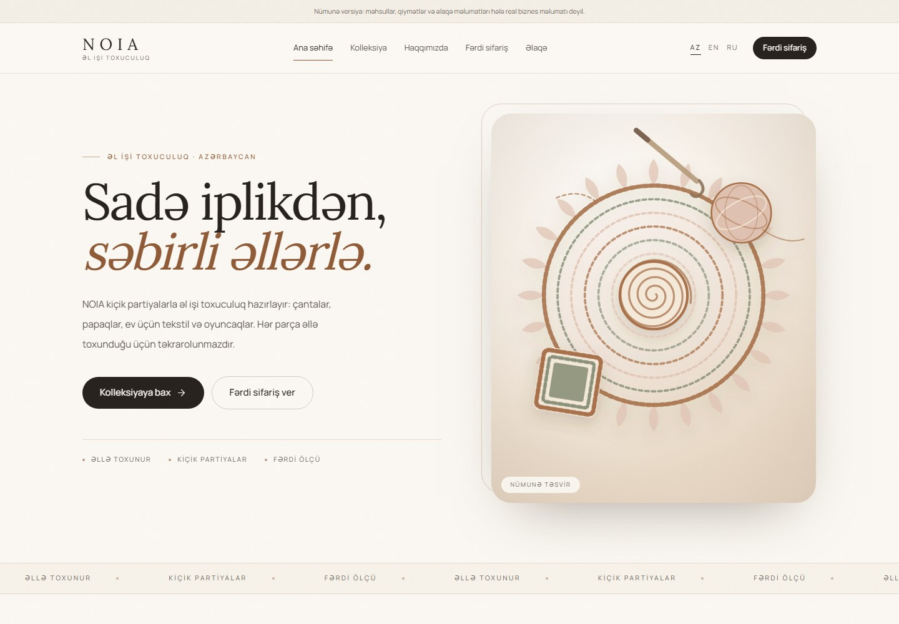
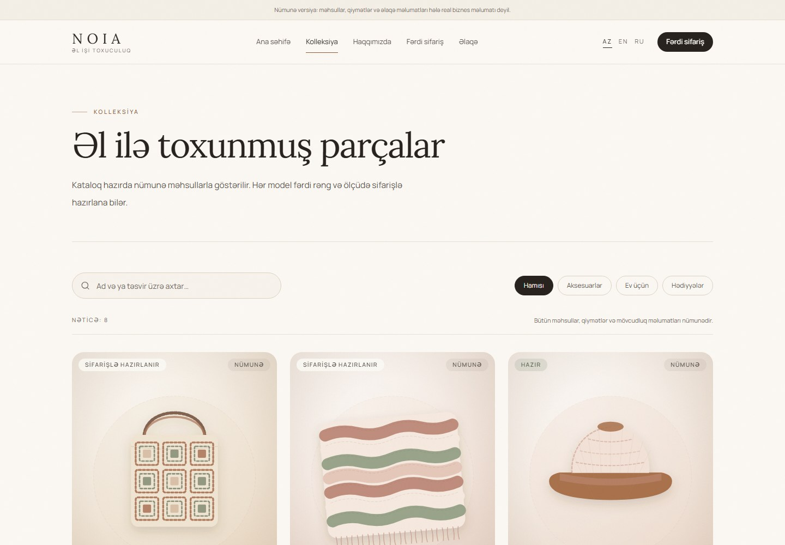
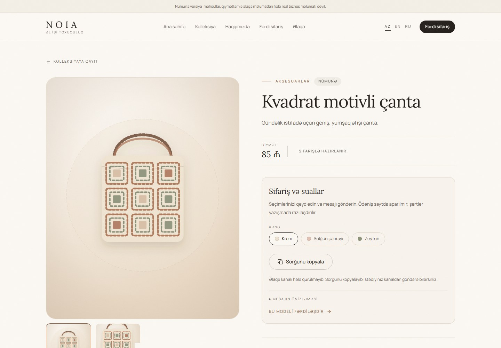
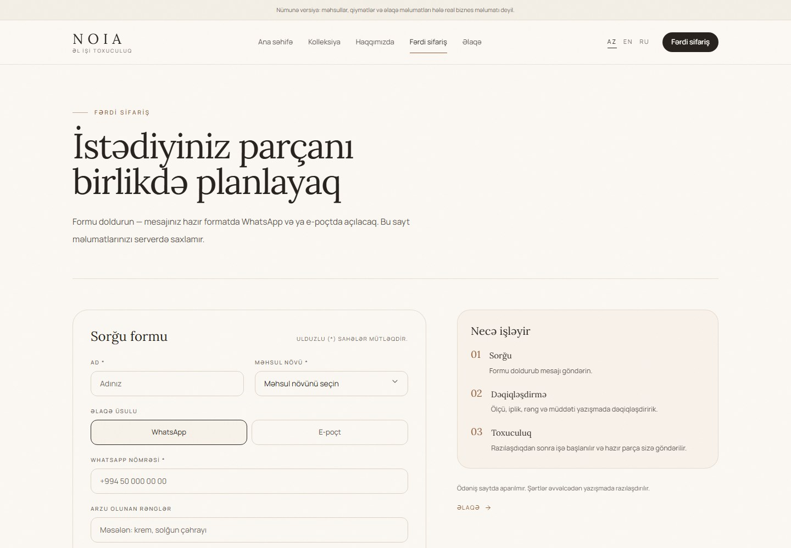
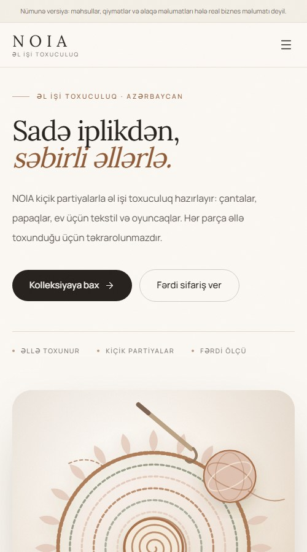

# NOIA — handmade crochet, three languages, no backend

NOIA is a trilingual website for a small handmade crochet brand in Azerbaijan. I designed and built
the interface, content model and front-end architecture as a portfolio project.

The work explores how much a static React application can do without a server: a searchable
catalogue, product options, and a custom-order flow that prepares a structured message for WhatsApp
or e-mail while keeping the visitor in control.

> **Project status:** demo build. The catalogue, contact details and artwork are placeholders, and
> the site has not been deployed. See [Current limitations](#current-limitations).



## At a glance

| Aspect         | Detail                                                              |
| -------------- | ------------------------------------------------------------------- |
| **Type**       | Brand website / front-end portfolio project                         |
| **Role**       | Product design, UI design, front-end development, documentation     |
| **Languages**  | Azerbaijani (default), English, Russian                             |
| **Stack**      | React 19, TypeScript 6, Vite 8, Tailwind CSS 4, React Router 7      |
| **Backend**    | None — static hosting, WhatsApp/e-mail handoff                      |
| **Quality**    | 73 automated tests, strict TypeScript, ESLint, Prettier             |
| **Lighthouse** | 100 accessibility, best practices and SEO on the audited page types |
| **Deployment** | Static build with SPA rewrites; Vercel and Netlify configs included |

## Context and goals

A small crochet business needs a web presence that feels personal, loads quickly and does not
require a server, database or payment integration. Visitors should be able to understand the brand,
browse pieces and start a conversation about a custom order.

The project was shaped around five goals:

1. Make the brand feel considered and handmade rather than like a generic template.
2. Support Azerbaijani, English and Russian without hiding content behind a client-only toggle.
3. Let visitors search and filter the catalogue on any connection.
4. Make a custom-order enquiry genuinely usable without pretending a backend received it.
5. Keep the codebase small, typed, tested and accessible.

## Product scope

- **Home** — brand statement, featured pieces, process, custom-order prompt and contact entry point.
- **Collection** — eight example products, search across localized text, and category filters.
- **Product detail** — gallery, price, availability, materials, care, option selection and a prepared
  enquiry panel.
- **Custom order** — validated form with name, contact method, product type, colours, description and
  optional deadline.
- **About and contact** — brand story, working approach and configuration-driven contact channels.
- **404** — a styled recovery page marked `noindex`.
- **Language switching** — stable URLs such as `/en/shop` and `/ru/tovar/...`, preserving the current
  page and query string.

## Design direction

The visual language is warm and editorial: ivory and cream surfaces, blush and clay accents, and a
serif/sans pairing (Lora and Manrope). Generous whitespace and restrained motion keep the focus on
the product story. The illustrations use the same palette so the demo feels cohesive without
pretending to be product photography.

## Screenshots

| Collection                                                            | Product                                              |
| --------------------------------------------------------------------- | ---------------------------------------------------- |
|  |  |

| Custom order                                            | Mobile home                                           |
| ------------------------------------------------------- | ----------------------------------------------------- |
|  |  |

Additional views: [English home](docs/screenshots/home-english.jpg),
[about](docs/screenshots/about.jpg), [contact](docs/screenshots/contact.jpg) and
[404](docs/screenshots/not-found.jpg).

## Architecture

```text
URL
 └─ matchRoute()          language + route + product slug
     └─ page component    Home / Shop / Product / About / Custom order / Contact / 404
         ├─ translations  AZ / EN / RU objects with the same shape
         ├─ product data  localized names, descriptions, options and images
         └─ lib/          validation, message builders, safe links, page metadata
```

### Language lives in the URL

Azerbaijani uses the root (`/`, `/kolleksiya`), English uses `/en/...` and Russian uses `/ru/...`.
Localized route slugs are defined once in `src/i18n/locales.ts`. This keeps shared links, browser
history and search indexing language-correct without cookies or `localStorage`.

### The catalogue is data, not markup

`src/data/products.ts` is the single source for the shop, product pages, related products and the
generated sitemap. Product copy, options and image alt text are stored in all three languages, and
TypeScript checks the translation shape.

### The enquiry is a handoff, not a fake API

The form sanitises and validates input in the browser, builds a readable plain-text message, and
exposes WhatsApp and e-mail deep links when those channels are configured. If they are not, it offers
copy-to-clipboard instead. The site never claims that a message was sent, never stores personal data
and does not accept file uploads; reference photos are arranged in the conversation.

### Configuration stays outside components

Public contact details and the demo flag live in `src/config/site.ts`. Invalid WhatsApp, e-mail or
Instagram values are treated as “not configured”, so the interface hides a channel rather than
shipping a broken link. Message parameters are URL-encoded before they reach `wa.me` or `mailto:`.

### Static hosting with client-side routes

The app builds to static files. Because the router uses real URLs, the host must rewrite unknown
paths to `index.html`. `vercel.json` and `netlify.toml` provide that fallback plus basic security
headers and long-lived cache headers for fingerprinted assets.

## Accessibility and SEO

- Semantic landmarks and heading order, a skip link, visible focus states and keyboard-operable
  controls.
- Form fields use real labels, `aria-invalid`, `aria-describedby` and a focused error summary.
- Muted text colours meet WCAG AA contrast on ivory and cream.
- Decorative motion respects `prefers-reduced-motion` and never gates content visibility.
- Each route updates its title, description, canonical URL, hreflang alternates, Open Graph and
  Twitter metadata. The 404 page is marked `noindex`.
- `robots.txt`, a generated 39-URL sitemap and a 1200×630 social preview are included.
- Product pages fall back to the branded PNG social image while the catalogue uses SVG artwork,
  because social crawlers generally do not render SVG.

Client-side rendering is the main SEO trade-off. The metadata is correct after React runs, but the
initial HTML contains only the Azerbaijani defaults. For a content-heavy production launch, the next
step would be prerendering or static generation; this limitation is documented rather than hidden.

## Testing and verification

```text
npm run format:check   pass
npm run typecheck      pass
npm run lint           pass
npm test               73 tests / 8 files
npm run build          pass
```

The suite covers locale parsing and URL building, translation completeness, product data, contact
validation, inquiry sanitisation and validation, message/link generation, sitemap coverage and the
main user journeys. A production preview was checked for console errors, failed requests and broken
images.

Lighthouse scored **100 for Accessibility, Best Practices and SEO** on the home, collection, product,
about, contact, custom-order and 404 pages in the Azerbaijani build. These are desktop audits of the
local production build; performance was not benchmarked as a stable claim.

## Project structure

```text
src/
  components/   layout and reusable UI
  config/       contact details, domain and demo flag
  data/         example catalogue
  features/     product cards, gallery and inquiry form
  i18n/         locale helpers and AZ/EN/RU translations
  lib/          validation, links, formatting and page metadata
  pages/        route-level components
  styles/       Tailwind import and design tokens
  types/        shared TypeScript types
public/         artwork, favicon, social preview, robots and sitemap
scripts/        artwork and sitemap generators
tests/          Vitest + Testing Library
docs/screenshots/
```

## Running locally

Node.js 24 or newer is required. The sitemap generator imports TypeScript directly.

```bash
npm install
npm run dev
```

Open `http://localhost:5173`.

Useful checks:

```bash
npm run format:check
npm run typecheck
npm run lint
npm test
npm run build
```

`npm run build` regenerates `public/sitemap.xml`, type-checks and writes the production build to
`dist/`.

## Content model

The project is intentionally content-driven rather than hardcoded into pages:

- **Contact and domain:** `src/config/site.ts`.
- **Products:** `src/data/products.ts` — localized copy, price, availability, options and images.
- **Interface text:** `src/i18n/translations/{az,en,ru}.ts`; Azerbaijani defines the canonical shape.
- **Artwork:** `public/images/` — currently generated SVG illustrations.

The current product imagery is illustrative. Replacing it with compressed JPEG/WebP photography
automatically improves product social previews, because the metadata hook only accepts raster images
for Open Graph.

## Current limitations

- **Placeholder content:** all eight products, prices and availability states are examples.
- **No contact details:** e-mail, WhatsApp and Instagram are empty. The enquiry flow shows only
  copy-to-clipboard until the owner configures real channels; no real WhatsApp or e-mail delivery was
  tested.
- **Illustration, not photography:** the artwork is original SVG generated for the demo. It is not a
  representation of real NOIA inventory.
- **Not deployed:** `noia.az` is assumed in configuration. No domain, DNS, hosting or TLS setup has
  been verified.
- **No backend features:** no accounts, payments, analytics, database or server-side form handling.
- **SPA SEO:** metadata is client-rendered; prerendering is the recommended production upgrade.

## Deployment

Deployment notes, domain setup, security headers and launch checks are in
[DEPLOYMENT.md](DEPLOYMENT.md). The repository includes `vercel.json` and `netlify.toml` with the SPA
rewrite React Router needs.

## License

No open-source license has been added. The NOIA name, brand copy and artwork belong to the project
owner. Add an explicit license before accepting outside contributions or republishing the code as a
template.
